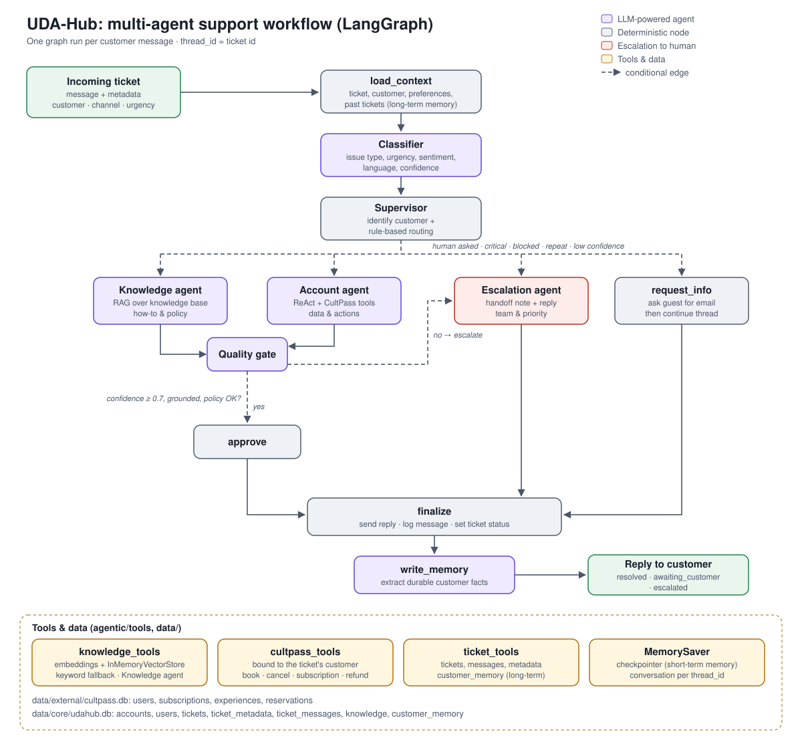

# UDA-Hub: Multi-Agent Customer Support with LangGraph

UDA-Hub is an intelligent, multi-agent decision suite that resolves customer support tickets for the
platforms it serves. It is built with LangGraph. The first integrated account is **CultPass**, a
subscription for cultural experiences.

A ticket in natural language, plus optional metadata (customer, channel, urgency), goes through these agents:

- **Classifier**: issue type, urgency, sentiment, language and confidence
- **Supervisor**: identifies the customer and routes the ticket with auditable rules
- **Knowledge agent**: answers from the knowledge base with RAG
- **Account agent**: uses CultPass tools (reservations, subscription, refund requests) scoped to the customer, which only accept ids it looked up
- **Quality gate**: approves the answer or escalates it, based on confidence, grounding and policy
- **Escalation agent**: hands off to the right human team with a summary
- **Memory**: short-term (the session's conversation, via the checkpointer) and long-term (preferences,
  reported issues and past tickets, in `udahub.db`), with filters that keep stale and one-off facts out

Business rules and policies are enforced in code, not left to prompts: the LLM proposes, and code decides. See
[Safeguards](solution/agentic/design/README.md#safeguards-the-llm-proposes-code-decides).



## Repository layout

| Path | Contents |
|---|---|
| `solution/` | The complete, working project, with its own guide in [`solution/README.md`](solution/README.md) |
| `requirements.txt` | Python dependencies |

```
solution/
├── 01_external_db_setup.ipynb   # rebuilds data/external/cultpass.db
├── 02_core_db_setup.ipynb       # rebuilds data/core/udahub.db
├── 03_agentic_app.ipynb         # demo scenarios (committed with outputs) and interactive chat
├── agentic/
│   ├── workflow.py              # LangGraph graph: `orchestrator`, `process_ticket()`
│   ├── agents/                  # classifier, supervisor, resolvers, quality gate, escalation, memory
│   ├── tools/                   # CultPass tools, RAG retriever, ticket and memory storage
│   ├── design/                  # architecture diagram, Mermaid graph and design document
│   ├── config.py                # models, paths and thresholds
│   └── state.py                 # graph state and structured-output schemas
├── data/                        # SQLAlchemy models, JSONL seed data and the SQLite databases
└── tests/                       # offline unit and end-to-end tests
```

### Documentation

| README | What it covers |
|---|---|
| [`solution/README.md`](solution/README.md) | Guide for reviewers: ticket flow, demo results, and where each requirement is met |
| [`agentic/design/`](solution/agentic/design/README.md) | Architecture, routing rules, resolve-or-escalate logic, memory, and safeguards |
| [`agentic/agents/`](solution/agentic/agents/README.md) | Each agent node, the long-term memory rules, and how to add an agent |
| [`agentic/tools/`](solution/agentic/tools/README.md) | Each tool and the rules it enforces, retrieval, and how to add a tool |
| [`data/core/`](solution/data/core/README.md) | `udahub.db`: tables, committed contents, and how the agents write to it |
| [`data/external/`](solution/data/external/README.md) | `cultpass.db`: demo customers, resetting, and adding data |

## Getting Started

### Dependencies

Python 3.11+ and an OpenAI API key. Python packages are listed in `requirements.txt`: LangGraph, LangChain, langchain-openai, NumPy (needed for embedding search), SQLAlchemy, python-dotenv and pytest.

### Installation

```bash
python -m venv .venv && source .venv/bin/activate
pip install -r requirements.txt
cd solution
cp .env.example .env          # then add your OPENAI_API_KEY (and OPENAI_BASE_URL if using Vocareum)
```

Put your key in `.env`, which git ignores, and never in `.env.example`, which is committed.

Both databases are committed, so you can open `03_agentic_app.ipynb` straight away. It runs 8 demo scenarios and
then an interactive chat. The other two notebooks rebuild the databases, so run them only to reset the data:
the demos make real bookings and cancellations, and store tickets and memories.

1. `01_external_db_setup.ipynb` rebuilds `data/external/cultpass.db` (customers, subscriptions, experiences, reservations)
2. `02_core_db_setup.ipynb` rebuilds `data/core/udahub.db` (account, 18 knowledge articles, tickets, demo history and memory)

Programmatic use (from `solution/`):

```python
from agentic.workflow import orchestrator, process_ticket
state = process_ticket("I'd like to cancel my reservation", "T-1", {"email": "cathy.bloom@florals.org"})
print(state["final_response"])
```

## Testing

From `solution/`:

```bash
python -m pytest tests
```

The tests need no API key. Each one runs against a temporary copy of the databases, so your data is not modified.

### Break Down Tests

- `tests/test_tools.py` covers the deterministic building blocks:
  - CultPass tool business rules: blocked accounts, inactive subscriptions, double booking, ownership checks, quota and subscription state transitions
  - account tools that are bound to one customer, and that refuse reservation or experience ids not looked up in the same turn
  - ticket creation and linking, metadata and long-term memory
  - the memory filters, which drop reservation state, named experiences, one-off requests and contact details, and the duplicate check, which ignores case and punctuation
  - the repeat-issue rule, which escalates repeated problems but not routine requests
  - keyword retrieval quality
  - every routing rule and escalation rule
- `tests/test_workflow.py` runs the whole LangGraph workflow end to end with a scripted fake LLM:
  - a RAG resolution
  - a low-confidence answer that gets escalated
  - a blocked customer who is escalated straight away
  - a multi-turn guest who is identified by email, with short-term and long-term memory recall
  - a refund request that forces escalation and stores a new memory
  - a memory about reservation state that is filtered out before it reaches the database
  - a memory writer that only sees the customer's messages, never the assistant's replies
  - a repeat issue, from a previous ticket and from earlier on the same ticket, that goes straight to a human

## Demo Results

These are the results of running the 8 scenarios in `03_agentic_app.ipynb` against the real model (`gpt-4o-mini`
with `text-embedding-3-small` for retrieval). The executed notebook, with every decision trace and reply, is
committed in `solution/`.

| # | Ticket | Route and tools | Outcome | Long-term memory |
|---|---|---|---|---|
| 1 | Guest asks what a subscription includes and whether premium events cost extra | classifier → knowledge agent (top article scored 0.78) | Resolved with an answer grounded in the subscription and tiers articles | None (guest) |
| 2 | Cathy asks about her reservations, then says "cancel that one" | account agent: `get_my_reservations`, then `cancel_my_reservation` | Resolved. The follow-up relied on short-term memory, and the reservation was cancelled with the credit returned | Cancellation memory dropped by the filter |
| 3 | Guest asks to book Samba Night, then gives their email | request_info → customer identified → account agent: `find_experiences`, `book_experience` | Resolved. Bob already had that booking, and the tool refused a duplicate | None (no duplicate of his stored preference) |
| 4 | Alice, whose account is blocked, can't log in | supervisor → escalation agent | Escalated to Trust & Safety (high priority) without revealing the reason for the block | Login issue recorded |
| 5 | Frank was charged twice | account agent: `request_refund` | Escalated to billing for support-lead approval, with no refund amount or timeline promised | Double charge and refund request recorded |
| 6 | Bob still can't log in after a password reset | supervisor → escalation agent (repeat issue: his previous ticket was a login problem) | Escalated to technical support | Login issue recorded |
| 7 | Bob asks for a recommendation | account agent: `find_experiences` | Suggested real upcoming Rio experiences that match his stored music and dance preference and his premium tier | None |
| 8 | Cathy demands a real person | supervisor → escalation agent | Escalated immediately | None (one-off request) |

The safeguards each did their job during the run:

- **Id guard:** in most of our runs of scenario 2, the agent first tried to cancel with an id it guessed. The tool refused it, and the agent looked the reservation up before cancelling. In other runs, including the committed one, the agent looked it up first. Either way the outcome is the same, and `test_account_tools_refuse_ids_not_looked_up` checks the guard directly.
- **Policy escalation:** refunds and blocked accounts always reached a human, whatever the model drafted.
- **Repeat issues:** in scenario 6 Bob's previous ticket was a login problem, so the supervisor escalated him straight away. This took the same route in 4 out of 4 runs.
- **Memory hygiene:** memories are third-person summaries of what the customer wrote, never the assistant's replies. Reservation state, named experiences, one-off requests, contact details and duplicates are not stored.

The model's wording varies from run to run, but the routes and outcomes above were the same across repeated runs.

## Project Instructions

Paths are relative to `solution/`.

| Deliverable | Where |
|---|---|
| Multi-agent architecture (Supervisor, Classifier, Resolvers, Escalation) | `agentic/agents/`, `agentic/workflow.py` |
| Architecture design | `agentic/design/README.md` |
| Input handling (text + metadata) | `process_ticket(...)`, `load_context` |
| Routing, RAG, resolve or escalate | `supervisor.py`, `knowledge_agent.py`, `quality_gate.py` |
| Tools (incl. internal refund tool) | `agentic/tools/` |
| Memory (state, short-term, long-term) | `memory_agent.py`, `ticket_tools.py`, `CustomerMemory` model |
| Knowledge base (≥ 14 articles) | `data/external/cultpass_articles.jsonl` (18) |
| Demo (committed with outputs) | `03_agentic_app.ipynb` |
| Safeguards enforced in code | `agentic/design/README.md#safeguards-the-llm-proposes-code-decides` |

## Built With

* [LangGraph](https://langchain-ai.github.io/langgraph/) - Agent orchestration, state and checkpointing
* [LangChain](https://python.langchain.com/) - Tools, vector store and model integrations
* [OpenAI](https://platform.openai.com/) - `gpt-4o-mini` chat model and `text-embedding-3-small` embeddings
* [SQLAlchemy](https://www.sqlalchemy.org/) - Core (`udahub.db`) and external (`cultpass.db`) databases
* [NumPy](https://numpy.org/) - Cosine similarity for embedding search
