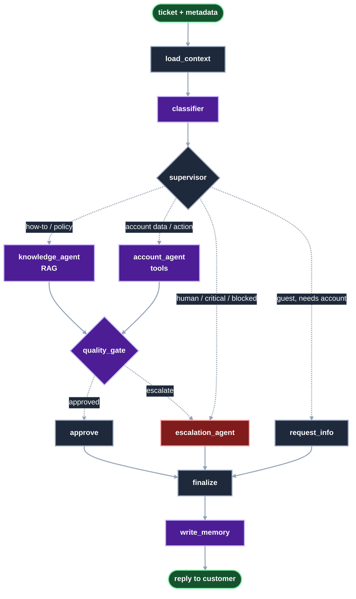

# UDA-Hub: Reference Solution

This folder contains the complete, working UDA-Hub project for reviewers. UDA-Hub is a LangGraph multi-agent
system that resolves customer support tickets for CultPass. It classifies each ticket, routes it to the right
agent, and then either resolves it (with RAG and account tools) or escalates it to a human. It uses short- and
long-term memory throughout.

The full architecture, routing rules and memory design are in [`agentic/design/README.md`](agentic/design/README.md).
Its [Safeguards](agentic/design/README.md#safeguards-the-llm-proposes-code-decides) section lists every business rule
and policy that is enforced in code rather than left to the model.

## How a ticket flows



Purple nodes use the LLM, gray nodes are plain code, red is the escalation to a human, and dashed arrows are conditional routes.

| Agent | What it does |
|---|---|
| **Classifier** | Gives the ticket a structured classification: issue type, urgency, sentiment, language, whether account action is needed, and confidence |
| **Supervisor** | Identifies the customer (from metadata or an email in the conversation) and routes the ticket with deterministic rules |
| **Knowledge agent** | Answers how-to and policy questions with RAG over the 18 knowledge base articles |
| **Account agent** | A ReAct agent with CultPass tools bound to the current customer: account, reservations, booking, cancellation, subscription changes and refund requests. Booking and cancellation only accept ids that a lookup returned in the same turn |
| **Quality gate** | Scores the draft reply for confidence and checks that it is backed by the articles or tool results. It escalates on low confidence (< 0.7), an unsupported draft, or a policy that needs a human (such as a refund) |
| **Escalation agent** | Picks the human team and priority, saves a handoff note on the ticket, and replies to the customer |
| **Memory** | Short-term: the conversation per ticket thread (`MemorySaver`). Long-term: customer preferences and reported issues (`customer_memory` table) and previous tickets in `udahub.db`. Reservation state, one-off requests and duplicates are filtered out |

## Running it

From the repository root:

```bash
python -m venv .venv && source .venv/bin/activate
pip install -r requirements.txt
cd solution
cp .env.example .env        # add OPENAI_API_KEY (and OPENAI_BASE_URL if using Vocareum)
```

Put the key in `.env`, which git ignores, and never in `.env.example`, which is committed.

`03_agentic_app.ipynb` is committed with the outputs of a real run (see below), so you can review it without a key.
To run it yourself, open it straight away: both databases are included. It runs the demo scenarios, then an
interactive chat (`chat_interface(orchestrator, "1")`).

The demos make real changes: bookings and cancellations, plus new tickets and memories. To reset the data, re-run:

1. `01_external_db_setup.ipynb`, which rebuilds `data/external/cultpass.db`
2. `02_core_db_setup.ipynb`, which rebuilds `data/core/udahub.db`

## Demo results (notebook 03)

`03_agentic_app.ipynb` is committed with the outputs of a run against the real model (`gpt-4o-mini`, with
`text-embedding-3-small` for retrieval), so you can read every decision trace and reply without running it.

| # | Ticket | What happened | Long-term memory |
|---|---|---|---|
| 1 | Guest asks what a subscription includes | knowledge_agent (top article scored 0.78) → resolved | None (guest) |
| 2 | Cathy asks about her reservations, then "cancel that one" | account_agent lists them, then cancels on the follow-up (short-term memory) → resolved | Cancellation dropped by the filter |
| 3 | Guest asks to book Samba Night, then gives their email | request_info → Bob identified → account_agent finds he already has that booking | None (no duplicate preference) |
| 4 | Alice (blocked account) can't log in | supervisor → escalated to Trust & Safety without revealing the reason for the block | Login issue recorded |
| 5 | Frank was charged twice | account_agent → `request_refund` → escalated to billing for support-lead approval | Refund request recorded |
| 6 | Bob still can't log in | knowledge_agent → quality gate wants a human → escalated to technical support | Login issue recorded |
| 7 | Bob asks for a recommendation | account_agent → `find_experiences` → real Rio experiences matching his stored preference and premium tier | None |
| 8 | Customer demands a human | Escalated immediately | None (one-off request) |

In scenario 2 the agent first tried to cancel with a guessed id. The tool refused it, and the agent looked the
reservation up before cancelling. The model's wording varies between runs, but the routes and outcomes were the
same across repeated runs.

## Tests

These need no API key. They use a scripted fake LLM and temporary copies of the databases.

```bash
python -m pytest tests
```

- `tests/test_tools.py` covers:
  - the tool business rules: blocked accounts, inactive subscriptions, double booking, ownership, quota and subscription transitions
  - account tools bound to one customer, which refuse ids that weren't looked up in the same turn
  - ticket and memory persistence
  - the memory filters (reservation state, one-off requests) and the duplicate check
  - keyword retrieval
  - every routing and escalation rule
- `tests/test_workflow.py` runs the whole graph end to end through these paths:
  - RAG resolution
  - low-confidence escalation
  - a blocked customer
  - multi-turn identification, recalling both short-term and long-term memory
  - a refund request that forces escalation and writes a new memory
  - a reservation-state memory that is filtered out before it is stored

## Folder guide

| Path | Contents |
|---|---|
| `agentic/workflow.py` | The LangGraph graph (`orchestrator`) and `process_ticket()` |
| [`agentic/agents/`](agentic/agents/README.md) | Classifier, supervisor, knowledge and account resolvers, quality gate, escalation, memory. The README covers the memory rules and how to add an agent. |
| [`agentic/tools/`](agentic/tools/README.md) | CultPass account tools, RAG retriever, ticket and memory storage. The README covers the rules each tool enforces and how to add a tool. |
| [`agentic/design/`](agentic/design/README.md) | Architecture diagram, Mermaid graph, and the design document: routing rules, resolve-or-escalate logic, memory, and safeguards |
| `agentic/config.py` | Models, database paths and decision thresholds |
| `agentic/state.py` | Graph state and structured-output schemas |
| [`data/core/`](data/core/README.md) | `udahub.db`: tables, committed contents, how the agents write to it, and adding articles |
| [`data/external/`](data/external/README.md) | `cultpass.db`, the JSONL seed data, the demo customers, resetting, and adding data |
| `data/models/` | SQLAlchemy models for both databases |
| `tests/` | Unit tests and end-to-end graph tests |
| `utils.py` | Starter helpers, including `chat_interface` |

The project overview for the whole repository is in the [root README](../README.md).

## Where to find each requirement

| Requirement | Location |
|---|---|
| Multi-agent architecture with LangGraph | `agentic/workflow.py`, `agentic/agents/` |
| Input handling (text and metadata) | `process_ticket()` in `agentic/workflow.py`, `load_context` in `agentic/agents/memory_agent.py` |
| Classification and routing | `agentic/agents/classifier.py`, `agentic/agents/supervisor.py` |
| RAG over the knowledge base | `agentic/tools/knowledge_tools.py`, `agentic/agents/knowledge_agent.py` |
| Tools, including the internal refund tool | `agentic/tools/cultpass_tools.py` |
| Resolve or escalate | `agentic/agents/quality_gate.py`, `agentic/agents/escalation_agent.py` |
| Memory: state, short-term and long-term | `agentic/state.py`, `agentic/agents/memory_agent.py`, `agentic/tools/ticket_tools.py`, `CustomerMemory` in `data/models/udahub.py` |
| At least 14 knowledge articles | `data/external/cultpass_articles.jsonl` (18 articles) |
| Configuration and thresholds | `agentic/config.py` (overridable with env vars) |
| Safeguards enforced in code | [`agentic/design/README.md`](agentic/design/README.md#safeguards-the-llm-proposes-code-decides) |
| Demo run with outputs | `03_agentic_app.ipynb`, summarised under [Demo results](#demo-results-notebook-03) |
