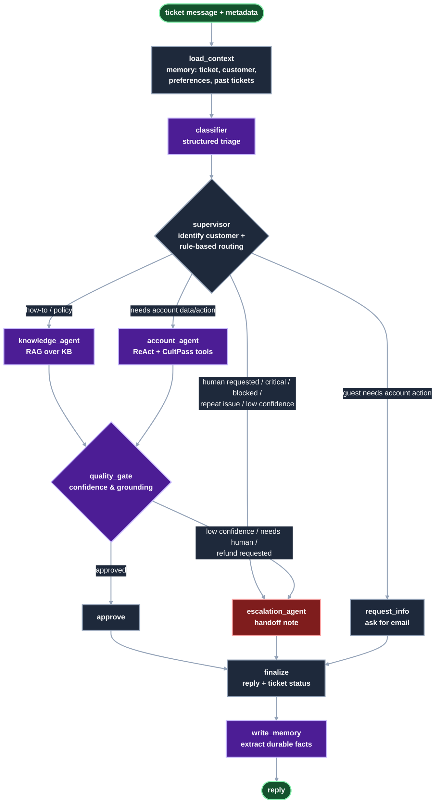

# UDA-Hub Architecture

UDA-Hub is a LangGraph multi-agent system that resolves customer support tickets for the
accounts it serves (currently **CultPass**). It reads tickets in natural language, together with optional
metadata. It routes each one to a specialised agent, which resolves it with RAG and account tools or
escalates it to a human. Throughout, it uses short- and long-term memory.


Files in this folder:

| File | Contents |
|---|---|
| `architecture.svg` | The architecture diagram above: agents, decision paths, tools, data stores and memory |
| `workflow_graph.mmd` | Mermaid source exported from the compiled graph (`orchestrator.get_graph().draw_mermaid()`), with a dark `classDef` color scheme added at the end (same color meaning as `architecture.svg`). Re-apply them if you regenerate the file. |
| `README.md` | This design document |

The same flow as a Mermaid diagram:



## Architecture pattern: Supervisor

UDA-Hub follows the **Supervisor** pattern. One central node, the `supervisor`, decides which specialist worker
handles each ticket. The workers never hand off to each other directly: every path returns through a shared
review and finalisation step.

| Pattern element | In UDA-Hub |
|---|---|
| Supervisor | `supervisor`: routes every ticket using the classifier's analysis and the customer's context |
| Specialist workers | `knowledge_agent` (RAG), `account_agent` (tools), `escalation_agent` (human handoff), `request_info` |
| Shared context | `UdaHubState`, the single state object that every node reads and updates |
| Support stages | `load_context` and `classifier` run before the supervisor; `quality_gate`, `finalize` and `write_memory` run after the workers |

Why Supervisor rather than the alternatives:

- **Not Network.** In a network, agents hand tickets to each other freely. Support needs one accountable decision
  point, so that policies like "blocked accounts go to Trust & Safety" are applied in one place, every time.
- **Not Hierarchical.** Hierarchical setups have several layers of supervisors. With one product (CultPass) and four
  workers there is nothing for a second layer to manage. Adding a platform would mean adding workers and routes,
  not another supervisor.
- **The supervisor's routing is code, not an LLM.** The LLM classifies the ticket, and `route_ticket()` turns that
  classification into a route with explicit rules. This makes every routing decision predictable, testable and
  explained in the trace. It is also why the project uses a custom `StateGraph` rather than `langgraph-supervisor`,
  whose supervisor is an LLM that chooses the handoff itself.
- **A quality gate reviews the workers' output.** A worker's draft is never sent directly. The `quality_gate` checks
  it, and can still send the ticket to escalation.

## Agents

| Node | Type | Responsibility |
|---|---|---|
| `load_context` | deterministic | Resolves the ticket from `thread_id`, creating it in `udahub.db` if it doesn't exist yet. It identifies the customer from metadata (`external_user_id` or `email`), stores the inbound message, and recalls long-term memory. It also resets the per-turn fields. |
| `classifier` | LLM, structured output | Produces a `TicketClassification` with issue type (11 categories), urgency, sentiment, whether account action is needed, whether a human was requested, any email mentioned, language and confidence. Recommendations and availability questions count as account work, because they need the real catalog. |
| `supervisor` | deterministic | Links a guest ticket to a customer when the classifier found their email. It then applies the routing rules below. The LLM classifies, but the routing itself stays auditable and testable code. |
| `knowledge_agent` | RAG | Retrieves the top 3 KB articles for the account. With no relevant article above the score threshold, it produces no draft and the ticket escalates. Otherwise it answers grounded in those articles, in the customer's language. |
| `account_agent` | ReAct agent (`create_react_agent`) | Uses CultPass tools **bound to the current customer**: account, reservations, experience search, booking, cancellation, subscription changes, refund requests and KB search. Booking and cancellation only accept ids that a lookup returned in the same turn. It recommends real experiences from the catalog, and asks a clarifying question when the request is ambiguous. |
| `quality_gate` | LLM, structured output, plus rules | Scores the draft against the evidence (articles or tool results) for confidence, grounding, whether a human is needed and whether it waits on the customer. `should_escalate` then decides deterministically. |
| `approve` | deterministic | Runs when the quality gate passes the draft, and makes the draft the reply. |
| `escalation_agent` | LLM, structured output | Picks the team and priority, writes a handoff note (stored as a `system` ticket message) and an empathetic reply. It never reveals block reasons and never promises refunds. |
| `request_info` | deterministic | Asks the customer to identify themselves and keeps the ticket open (`awaiting_customer`). |
| `finalize` | deterministic | Appends the reply to the conversation, persists it, and updates the ticket's status, issue type and tags. |
| `write_memory` | LLM, structured output, plus filters | Extracts durable preferences, personal facts and reported issues as third-person summaries. Code then drops reservation state and one-off requests and skips duplicates. Secrets and payment data are never stored. |

## Information flow

One graph run handles one customer message. Each node reads the shared state and writes only its own fields:

| Step | Node | Reads | Writes |
|---|---|---|---|
| 1 | `load_context` | `messages`, `metadata`, `thread_id` | `ticket_id`, `customer`, `memories`, `prior_tickets`, `ticket_history`, `ticket_status`, `ticket_issue_type`. It also resets the per-turn fields and saves the customer's message to `udahub.db`. |
| 2 | `classifier` | conversation, customer context | `classification`: issue type, urgency, sentiment, language, whether account action or a human is needed, any email, confidence |
| 3 | `supervisor` | `classification`, `customer`, `prior_tickets`, `ticket_status`, `metadata.urgency` | `route`, `route_reason`. A guest is linked to their account if the classifier found their email. |
| 4a | `knowledge_agent` | `classification`, conversation, customer context | `knowledge` (retrieved articles), `draft_response` |
| 4b | `account_agent` | conversation, customer context | `actions_taken` (every tool call and result), `draft_response` |
| 4c | `request_info` | `classification` | `final_response` (asks for the customer's email, in their language) |
| 5 | `quality_gate` | `draft_response`, `knowledge`, `actions_taken`, `prior_tickets` | `assessment`. Then `should_escalate()` picks `approve` or `escalation_agent`. |
| 6 | `approve` or `escalation_agent` | the draft, or everything above | `final_response`. Escalation also writes `escalation` (team, priority, summary, steps taken) and saves a handoff note to the ticket. |
| 7 | `finalize` | `final_response`, `route`, `escalation`, `assessment` | `messages` (the reply), `ticket_status`. It also saves the reply and the ticket's status, issue type and tags. |
| 8 | `write_memory` | the customer's messages only | New rows in `customer_memory`, after the filters |

Every node also appends one line to `trace`, so each decision can be audited after the fact.

## Routing rules (`supervisor.route_ticket`)

The rules are evaluated in order:

1. Ticket already `escalated` → **escalation** (follow-ups are forwarded to the human team)
2. Customer asked for a human → **escalation**
3. `legal_or_safety` issue, or `critical` urgency → **escalation**. Urgency is the more severe of the classifier's and
   the one reported in the ticket metadata, so the LLM can raise a ticket's urgency but never lower what the source
   system reported (`effective_urgency`).
4. Classifier confidence < `0.5` → **escalation**
5. Blocked customer whose issue involves their account: login, reservations, subscription, billing, a complaint, or any account action → **escalation** (Trust & Safety policy)
6. Identified customer reports a blocked account → **escalation**
7. Repeat problem: the customer reported the same issue type in a previous ticket, or this ticket was already
   resolved for it and they wrote again. Applies to login, technical, billing/refund, privacy and complaint issues
   → **escalation** (the documented fix didn't work). Reservations and subscription changes are routine and
   expected to repeat, so they're excluded.
8. Account data or action needed, customer unknown → **request_info**
9. Account data or action needed (`reservation`, `subscription`, `billing_refund`, or `requires_account_action`) → **account_agent**. This includes recommendations.
10. Otherwise → **knowledge_agent**

A blocked customer can still get answers to general questions, such as what a subscription includes.

## Resolve vs. escalate (`quality_gate.should_escalate`)

Any of these triggers an escalation:

- a policy-gated tool succeeded (`request_refund`: refunds require support-lead approval)
- the gate says a human is needed
- the draft is not grounded in the evidence
- the gate's confidence is below `0.7`
- the resolver produced no draft (no relevant article, or the agent hit its step limit)

Thresholds are set in `agentic/config.py` and can be overridden with env vars.

## Memory

| Kind | Where | What |
|---|---|---|
| **State** | `UdaHubState` (LangGraph) | Classification, route, retrieved articles, tool actions, assessment and trace for the current step of the execution. |
| **Short-term** | `MemorySaver` checkpointer, keyed by `thread_id` = ticket id | The session's conversation, customer and metadata, so follow-ups ("cancel *that one*") work within a session. |
| **Long-term** | `udahub.db`: `customer_memory` table, plus `tickets` and `ticket_messages` | Customer preferences, personal facts and reported issues, previous tickets (issue, status, last reply) and the full message log. These are recalled at the start of every new ticket for that customer. Only facts the customer stated are stored. State the system can look up live, such as reservations, is never stored, so it can't go stale. |

## Tools (`agentic/tools`)

- `cultpass_tools.py`: plain functions over `cultpass.db` that enforce the business rules: blocked accounts, active
  subscription, premium tier, slots, monthly quota and ownership checks. `build_account_tools(user_id, ticket_id)`
  wraps them as LangChain tools with the customer id bound in, so the LLM can't act on another account. The
  wrappers also refuse reservation and experience ids that no lookup returned in the same turn.
- `knowledge_tools.py`: `KnowledgeRetriever` builds an `InMemoryVectorStore` with OpenAI embeddings
  (`text-embedding-3-small`) over the account's `knowledge` table, and keeps articles scoring at least 0.30. If
  embeddings are unavailable, it falls back to IDF keyword scoring.
- `ticket_tools.py`: ticket creation and linking, message log, metadata updates, prior tickets, and long-term memory,
  with a duplicate check that ignores case and punctuation.

The tool tables are in [`../tools/README.md`](../tools/README.md).

## Safeguards: the LLM proposes, code decides

Each decision with real consequences is enforced in code rather than left to a prompt:

| Risk | Safeguard | Where |
|---|---|---|
| Acting on another customer's account | Tools have the customer id bound in, and ownership is checked | `build_account_tools`, `cancel_reservation` |
| Acting on a guessed id | Booking and cancellation refuse ids that no lookup returned in the same turn | `build_account_tools` |
| Breaking business rules | Blocked accounts, subscription status, tier, slots, quota and double booking are checked before every change | `reserve_experience`, `manage_subscription` |
| Promising a refund | Using `request_refund` always escalates, whatever the draft says | `should_escalate`, `ESCALATING_TOOLS` |
| Answering a blocked account, legal issue or human request | Routing rules send these to escalation before any resolver runs | `route_ticket` |
| Repeating a fix that already failed | A problem the customer reported before goes straight to a human | `route_ticket`, `repeat_issue_types` |
| Sending a wrong or unsupported answer | The draft is escalated when it isn't backed by the evidence or confidence is below 0.7 | `should_escalate` |
| Storing stale, invented or personal memories | The memory writer sees only the customer's messages. Filters drop reservation state, named experiences, one-off requests and contact details, and duplicates are skipped | `customer_messages_text`, `drop_reason`, `save_memory` |

These rules are covered by the offline tests in `tests/`. The demo results in the [root README](../../../README.md#demo-results)
show them working against the real model.

## Inputs and outputs

### Input

Each call carries one customer message, plus optional ticket metadata:

```python
from agentic.workflow import orchestrator, process_ticket

state = process_ticket(
    "I was charged twice this month",
    ticket_id="T-123",                         # = thread_id
    metadata={"email": "bob.stone@granite.com", "channel": "email", "urgency": "high"},
)
```

| Field | Required | Meaning |
|---|---|---|
| message text | Yes | The customer's message, in any language |
| `ticket_id` | Yes | Identifies the ticket. It is also the LangGraph `thread_id`, so follow-ups continue the same conversation. |
| `metadata.external_user_id` or `metadata.email` | No | Identifies the customer on the platform |
| `metadata.user_name` | No | Name for a newly created user |
| `metadata.account_id` | No | The platform; defaults to `cultpass` |
| `metadata.channel` | No | `chat`, `email`, and so on; defaults to `chat` |
| `metadata.urgency` | No | The urgency reported by the source system: `low`, `medium`, `high` or `critical`. The classifier sees it, and routing uses the more severe of it and the classifier's urgency, so a ticket reported as `critical` always reaches a human. |
| `metadata.tags` | No | Initial ticket tags |

`orchestrator` also works with the course-provided `utils.chat_interface(orchestrator, ticket_id)`, which sends
messages only.

### How each kind of input is handled

| Input | Handling |
|---|---|
| Known customer (id or email in metadata) | The account, subscription, preferences and past tickets are loaded before classification |
| Unknown customer, how-to or policy question | Answered from the knowledge base; nothing is stored about them |
| Unknown customer who needs an account action | `request_info` asks for their email, and the ticket waits (`awaiting_customer`) |
| Customer who writes their email in the message | The supervisor finds the account, links the ticket to it, and continues |
| Follow-up on the same ticket | The checkpointer supplies the earlier conversation, so "cancel *that one*" works |
| Ticket that already exists in `udahub.db` | Its earlier messages are loaded as history |
| Problem the customer reported before | Escalated straight away as a repeat issue |
| Ticket already escalated | New messages are forwarded to the human team |
| Request for a human, legal or safety issue, critical urgency (classified or reported in metadata) | Escalated straight away |
| Blocked account with an account issue | Escalated to Trust & Safety, without revealing the reason for the block |
| Ambiguous or off-topic message (classifier confidence < 0.5) | Escalated rather than guessed at |
| Message in another language | Classified with its language, and answered in that language. Even `request_info`'s fixed request for an email is translated; English speakers get the fixed text with no extra LLM call. |

### Output

`process_ticket()` returns the final state for the turn:

| Field | Contents |
|---|---|
| `final_response` | The reply sent to the customer |
| `ticket_status` | `resolved`, `awaiting_customer` or `escalated` |
| `route`, `route_reason` | Which worker handled the ticket, and why |
| `classification` | The classifier's analysis |
| `knowledge`, `actions_taken` | The articles used and the tool calls made, with their results |
| `assessment` | The quality gate's confidence, grounding and needs-a-human verdict |
| `escalation` | For escalated tickets: team, priority, summary, steps taken and recommended next step |
| `trace` | One line per decision, in order |

The run also writes to the databases:
- the customer's message and the reply, logged in `ticket_messages`;
- the ticket's status, issue type and tags, in `ticket_metadata`;
- for escalations, a handoff note, and for refund requests, a reference number;
- new long-term memories, in `customer_memory`;
- any bookings, cancellations or subscription changes, in `cultpass.db`.
