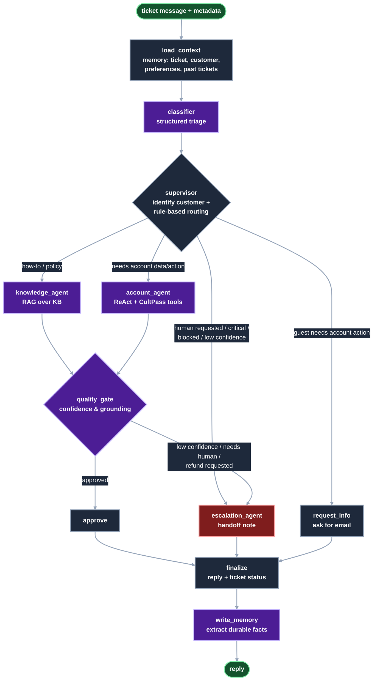

# UDA-Hub Architecture

UDA-Hub is a LangGraph multi-agent system that resolves customer support tickets for the
accounts it serves (currently **CultPass**). It reads tickets in natural language, together with optional
metadata. It routes each one to a specialised agent, which resolves it with RAG and account tools or
escalates it to a human. Throughout, it uses short- and long-term memory.


Files in this folder:

| File | Contents |
|---|---|
| `architecture.svg` | The architecture diagram above: agents, decision paths, tools, data stores and memory |
| `workflow_graph.mmd` | Mermaid source exported from the compiled graph (`orchestrator.get_graph().draw_mermaid()`), with a dark `classDef` color scheme added at the end (same color meaning as `architecture.svg`). Re-apply them if you regenerate the file. |
| `README.md` | This design document |

The same flow as a Mermaid diagram:



## Agents

| Node | Type | Responsibility |
|---|---|---|
| `load_context` | deterministic | Resolves the ticket from `thread_id`, creating it in `udahub.db` if it doesn't exist yet. It identifies the customer from metadata (`external_user_id` or `email`), stores the inbound message, and recalls long-term memory. It also resets the per-turn fields. |
| `classifier` | LLM, structured output | Produces a `TicketClassification` with issue type (11 categories), urgency, sentiment, whether account action is needed, whether a human was requested, any email mentioned, language and confidence. |
| `supervisor` | deterministic | Links a guest ticket to a customer when the classifier found their email. It then applies the routing rules below. The LLM classifies, but the routing itself stays auditable and testable code. |
| `knowledge_agent` | RAG | Retrieves the top 3 KB articles for the account. With no relevant article above the score threshold, it produces no draft and the ticket escalates. Otherwise it answers grounded in those articles, in the customer's language. |
| `account_agent` | ReAct agent (`create_react_agent`) | Uses CultPass tools **bound to the current customer**: account, reservations, experience search, booking, cancellation, subscription changes, refund requests and KB search. It asks a clarifying question when the request is ambiguous. |
| `quality_gate` | LLM, structured output, plus rules | Scores the draft against the evidence (articles or tool results) for confidence, grounding, whether a human is needed and whether it waits on the customer. `should_escalate` then decides deterministically. |
| `escalation_agent` | LLM, structured output | Picks the team and priority, writes a handoff note (stored as a `system` ticket message) and an empathetic reply. It never reveals block reasons and never promises refunds. |
| `request_info` | deterministic | Asks the customer to identify themselves and keeps the ticket open (`awaiting_customer`). |
| `finalize` | deterministic | Appends the reply to the conversation, persists it, and updates the ticket's status, issue type and tags. |
| `write_memory` | LLM, structured output | Extracts durable preferences and facts from the exchange and stores them, skipping duplicates. Secrets and payment data are never stored. |

## Routing rules (`supervisor.route_ticket`)

The rules are evaluated in order:

1. Ticket already `escalated` → **escalation** (follow-ups are forwarded to the human team)
2. Customer asked for a human → **escalation**
3. `legal_or_safety` issue or `critical` urgency → **escalation**
4. Classifier confidence < `0.5` → **escalation**
5. Blocked customer with an account-related issue → **escalation** (Trust & Safety policy)
6. Account data or action needed, customer unknown → **request_info**
7. Account data or action needed (`reservation`, `subscription`, `billing_refund`, or `requires_account_action`) → **account_agent**
8. Otherwise → **knowledge_agent**

## Resolve vs. escalate (`quality_gate.should_escalate`)

Any of these triggers an escalation:

- a policy-gated tool succeeded (`request_refund`: refunds require support-lead approval)
- the gate says a human is needed
- the draft is not grounded in the evidence
- the gate's confidence is below `0.7`
- the resolver produced no draft (no relevant article, or the agent hit its step limit)

Thresholds are set in `agentic/config.py` and can be overridden with env vars.

## Memory

| Kind | Where | What |
|---|---|---|
| **State** | `UdaHubState` (LangGraph) | Classification, route, retrieved articles, tool actions, assessment and trace for the current step of the execution. |
| **Short-term** | `MemorySaver` checkpointer, keyed by `thread_id` = ticket id | The session's conversation, customer and metadata, so follow-ups ("cancel *that one*") work within a session. |
| **Long-term** | `udahub.db`: `customer_memory` table, plus `tickets` and `ticket_messages` | Customer preferences and facts, previous tickets (issue, status, last reply) and the full message log. These are recalled at the start of every new ticket for that customer. |

## Tools (`agentic/tools`)

- `cultpass_tools.py`: plain functions over `cultpass.db` that enforce the business rules: blocked accounts, active
  subscription, premium tier, slots, monthly quota and ownership checks. `build_account_tools(user_id, ticket_id)`
  wraps them as LangChain tools with the customer id bound in, so the LLM can't act on another account.
- `knowledge_tools.py`: `KnowledgeRetriever` builds an `InMemoryVectorStore` with OpenAI embeddings over the account's
  `knowledge` table. If embeddings are unavailable, it falls back to IDF keyword scoring.
- `ticket_tools.py`: ticket creation and linking, message log, metadata updates, prior tickets, and long-term memory.

## Inputs and outputs

```python
from agentic.workflow import orchestrator, process_ticket

state = process_ticket(
    "I was charged twice this month",
    ticket_id="T-123",                         # = thread_id
    metadata={"email": "bob.stone@granite.com", "channel": "email", "urgency": "high"},
)
state["final_response"], state["route"], state["escalation"], state["trace"]
```

`orchestrator` also works with the starter's `utils.chat_interface(orchestrator, ticket_id)`.
